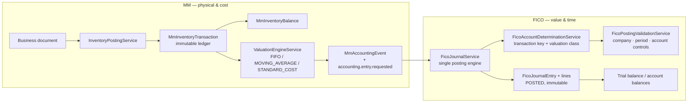

# MM → FICO Ledger Map

How every Materials Management movement turns into a financial document, and how the
shared ledger (charts, account groups, G/L accounts, posting controls, fiscal calendar)
is structured so that MM can post without ever knowing an account number.

Status: **verified against the code on 2026-11-05**. Code references are authoritative;
where this document and the code disagree, the code wins and this file must be fixed.

Related: [FICO_PHASE1_ARCHITECTURE.md](./FICO_PHASE1_ARCHITECTURE.md) ·
[MM_FICO_INTEGRATION.md](./MM_FICO_INTEGRATION.md) ·
[MM_ARCHITECTURE.md](./MM_ARCHITECTURE.md) ·
[MASTER_ENTERPRISE_SYSTEM_FLOW.md](./MASTER_ENTERPRISE_SYSTEM_FLOW.md)

---

## 1. The one rule that shapes everything

```text
MM  = quantity + cost        (one ledger, one posting engine)
FICO = value + accounts + time (one chart, one determined account pair, one open period)

MM never names a G/L account.  FICO never moves stock.
The bridge is one event, one key, one debit/credit pair per material line.
```



Three things therefore have to agree before a movement can be billed to the ledger:

| Agreement | Owner | Table |
| --- | --- | --- |
| What physically happened and what it cost | MM | `mm_inventory_transactions`, `mm_material_valuation` |
| Which accounts represent that event | FICO | `fico_mm_account_mappings` (+ `fico_gl_accounts`) |
| Whether that date may still be posted | FICO | `fico_financial_periods` (+ `fico_posting_period_controls`) |

---

## 2. Where the amount and the account scope come from (MM side)

Nothing in the accounting bridge invents a value. Both inputs are MM master data:

| Input to account determination | Source | Notes |
| --- | --- | --- |
| `companyId` | document | One FICO configuration per company |
| `postingDate` | document | Drives the fiscal period and mapping effective dates |
| `currencyCode` | material currency, else `USD` | Must match the company base currency (no FX engine) |
| line `totalCost` | document line | The absolute amount posted as both debit and credit |
| `valuationClassId` / `valuationClassCode` | `mm_materials.valuationClassId` → `mm_valuation_classes` | Selects a class-specific mapping over the `*` default |
| `movementType` | document / event type | Decides adjustment direction only |
| `warehouseId`, `plantId` | document / warehouse | Carried on the journal line for analysis |
| Unit cost basis | `mm_material_valuation` | `STANDARD_COST`, `MOVING_AVERAGE` or `FIFO` (cost layers in `mm_cost_layer`), valuation area = **warehouse** |

Two consequences worth stating explicitly:

* A material with **no valuation class** can still post — it resolves the `*` mapping. It
  cannot resolve a class-specific mapping, so class-specific configuration silently does
  nothing until the material is classified.
* Reclassifying a material's valuation class changes *which* mapping future movements use.
  It does not rewrite journals already posted.

Seeded valuation classes (`backend/prisma/seed-fico-phase1.ts`): `TRADING`,
`RAW_MATERIAL`, `FINISHED_GOOD`.

---

## 3. The MM flow, stage by stage

### 3.1 Stages that produce no accounting document

| Stage | Document | Why no FICO effect |
| --- | --- | --- |
| Demand / MRP | planned orders, recommendations | Planning only; MRP may never post stock or value |
| Procurement | PR → RFQ → quotation → PO | Commitment, not a posting |
| Inbound planning | ASN, expected receipt | Quantity expectation only |
| Reservation / allocation | `mm_inventory_reservations`, `mm_inventory_allocations` | Changes `reservedQuantity`, never physical `quantity` |
| Pick / pack | warehouse tasks, packing sessions | Physical handling before goods issue |
| Putaway / bin transfer / stock status change | posts `MmInventoryTransaction` via `InventoryPostingService` | Quantity moves location or status, not value. These do **not** emit a document accounting event (see the valuation caveat in §3.4) |

### 3.2 Stages that produce the financial documents

Each row is one `MmAccountingEvent` (plus, in most cases, one valuation event — §3.4).

| MM flow | Service | Accounting event | Effect hints | Transaction key today |
| --- | --- | --- | --- | --- |
| Goods receipt (PO, production receipt) | `stock-ops/goods-receipt.service.ts` | `GoodsReceiptPosted` | `INVENTORY_INCREASE`, `GRIR_ACCRUAL` | `GR_IR` |
| Goods issue — sales | `stock-ops/goods-issue.service.ts` (`issuePurpose: 'SALES'`) | `GoodsIssuePosted` | `INVENTORY_DECREASE`, `COGS_EXPENSE` | `GI_COGS` |
| Goods issue — internal / production | same (`INTERNAL`, `PRODUCTION`) | `GoodsIssuePosted` | same | `GI_EXPENSE` |
| Count adjustment (gain) | `stock-ops/adjustment.service.ts` (`ADJUSTMENT_IN`) | `InventoryAdjusted` | `INVENTORY_ADJUSTMENT` | `INVENTORY_INCREASE_ADJ` |
| Count adjustment / manual adjustment (loss) | same (`ADJUSTMENT_OUT`) | `InventoryAdjusted` | `INVENTORY_ADJUSTMENT` | `INVENTORY_SHRINKAGE` |
| Scrap / disposal | `returns-disposal/disposal.service.ts` | `ScrapPosted` / `DisposalPosted` | `INVENTORY_DECREASE`, `INVENTORY_LOSS` | `INVENTORY_SHRINKAGE` |
| Supplier return | `returns-disposal/supplier-return.service.ts` | `SupplierReturnPosted` | `INVENTORY_DECREASE`, `GRIR_REVERSAL` | **none — fails** |
| Customer return intake | `returns-disposal/customer-return.service.ts` | `CUSTOMER_RETURN_COMPLETED` (raw row) | none (malformed) | **none — never consumed** |
| Warehouse / stock transfer | `warehouse/transfers/transfers.service.ts`, `stock-ops/warehouse-transfer-order.service.ts` | `InventoryTransferred` | `TRANSFER_CLEARING` | **none — fails** |
| Landed cost allocation | `valuation/valuation-engine.service.ts` | `LandedCostAllocated` | `LANDED_COST` | `LANDED_COST` |
| Price variance (PPV/IPV) | `valuation/valuation-engine.service.ts` | `PriceVariancePosted` | `PRICE_VARIANCE` | `PRICE_VARIANCE` |
| Standard cost revaluation | `valuation/valuation-engine.service.ts` | `InventoryRevaluationPosted` | `INVENTORY_REVALUATION` | **none — fails** |
| Any document reversal | `InventoryPostingService.reverseTransaction` + the document service | `GoodsReceiptReversed`, `GoodsIssueReversed`, `SupplierReturnReversed`, `DisposalReversed`, `InventoryValuationReversed`, `InventoryTransactionReversed` | `REVERSAL` | **none — fails** |
| Supplier invoice (three-way match) | not implemented as a posting | `SupplierInvoiceMatched` | empty | **none — fails** |

"Fails" means: for a company whose FICO configuration is `ACTIVE`, the consumer marks the
`MmAccountingEvent` `FAILED` with a readable `lastError`. Companies with no FICO settings
keep the documented **legacy** behaviour — a header-only `POSTED` journal with no lines,
which the trial balance excludes. Nothing is ever silently posted to a guessed account.

### 3.3 Value flow on the MM side

```text
Goods receipt        → unit cost from the receipt line (PO price) → cost layer / moving average
Goods issue          → cost consumed by FIFO layers, moving average, or standard cost
Adjustment           → unitCost × |quantity| of the adjustment line
Scrap / disposal     → unit cost at the time of disposal
Landed cost          → allocated amount capitalised into inventory (raises layer / MAP)
Price variance       → difference between PO/invoice and valuation
Revaluation          → new standard cost vs previous valuation
```

### 3.4 The attached valuation event (important for reading the monitor)

`InventoryPostingService.runPostInTx()` calls
`ValuationEngineService.applyInTransaction()` **for every posting**, without exception.
That call records an `InventoryValuationUpdated` accounting event on each movement.

So a single goods receipt today tries to create **two** accounting events:

| Event | Resolves? | Result for an `ACTIVE` company |
| --- | --- | --- |
| `GoodsReceiptPosted` | `GR_IR` | `CONSUMED` — the real journal |
| `InventoryValuationUpdated` | no key defined | `FAILED` (historically an FK race; now a clear "no transaction key" error) |

This is why the posting monitor shows a steady stream of failures next to successful
postings; the failures are valuation-informational events, not missing stock journals.
Section 11 lists every event and its current outcome.

---

## 4. The accounting event contract

`backend/src/mm/common/mm-accounting-event.service.ts` + `mm-accounting-context.builder.ts`

| Field | Meaning |
| --- | --- |
| `schemaVersion: 'v2'` | Payload contract version |
| `eventType` | `GoodsReceiptPosted`, `GoodsIssuePosted`, `InventoryAdjusted`, … |
| `companyId`, `plantId`, `postingDate`, `currencyCode` | Resolution and period context |
| `documentType`, `documentId`, `sourceModule` | Back-reference to the MM document |
| `accountingEffects[]` | Semantic hints only — never account numbers |
| `lines[]` | `materialId`, `valuationClassId/Code`, `movementType`, `quantity`, `unitCost`, `totalCost`, `warehouseId`, `plantId` |
| `financiallyRelevant` | `true` when at least one effect hint exists |
| `idempotencyKey` | Default `eventType:documentType:documentId[:suffix]`, unique in the database |
| `mmAccountingEventId` | Link back to the persisted `mm_accounting_events` row |

Dispatch order (fixed on 2026-11-05): the row is written **inside** the inventory
transaction, and `accounting.entry.requested` is emitted **only after commit**
(`InventoryPostingService.dispatchAccounting`, `ValuationEngineService.dispatchAccounting`).
FICO can therefore always see the parent event when it writes the journal.

Statuses: `PENDING` → `CONSUMED` (journal written) or `FAILED` (with `lastError`).

---

## 5. The shared ledger structure

This is the part every MM posting depends on. Configure it in this order; later steps
validate against earlier ones.

```text
Company  ──1:1──►  FicoCompanyAccountingSettings      (status DRAFT → ACTIVE)
                          │
        ┌─────────────────┼──────────────────┬───────────────────────┐
        ▼                 ▼                  ▼                       ▼
  Chart of Accounts   Fiscal Year       Posting Period         Account Determination
  (global, reusable)  Variant           Variant                Profile (per company)
        │                 │                                          │
        ▼                 ▼                                          ▼
  Account Groups    Financial Periods                        Mappings:
  (hierarchy +      (per company, per year)                   key × valuation scope
   code ranges)          │                                          │
        │                ▼                                          ▼
        ▼          Posting Period Controls                   debit/credit G/L account
  G/L Accounts     (per period, per account-type scope)       (same chart, posting enabled)
        │
        ▼
  Company assignment (FicoCompanyGlAccount: posting enabled,
  manual blocked, effective dates)
```

### 5.1 Company accounting settings — the root (`fico_company_accounting_settings`)

| Field group | Values | Why MM cares |
| --- | --- | --- |
| Lifecycle | `DRAFT` / `ACTIVE` / `INACTIVE` | Only `ACTIVE` posts automatically. `DRAFT` blocks with "Automatic accounting is blocked…". No row at all = legacy header-only bridge |
| Base currency / country / timezone / method | defaults PHP / PH / Asia/Manila / ACCRUAL | Foreign-currency lines are rejected (no FX engine) |
| `chartOfAccountsId` | must be `ACTIVE` | Every resolved account must belong to this chart |
| `fiscalYearVariantId` | e.g. `PH_CALENDAR` | Defines the periods that allow/deny the posting date |
| `postingPeriodVariantId` | e.g. `PH_STANDARD` | Close checklist / special-period policy |
| `accountDeterminationProfileId` | one profile per settings row (unique) | Scopes which mappings are read |
| Document numbering | `documentNumberPrefix`, `documentNumberPadding` | Reserved for manual journals; automatic MM journals currently carry no sequence number |

Structural fields are editable only while `DRAFT` and never once accounting documents
exist. Every change is audited.

### 5.2 Chart of accounts (`fico_charts_of_accounts`)

* Global and reusable across companies; unique `code`; `ACTIVE` / `INACTIVE`.
* `accountCodeLength` (optional) pins every account code and group range to an exact
  length (e.g. 4 for `AGCTEK_COA`); codes are strings, so leading zeros survive.
* Duplicating a chart copies groups, ranges and accounts into a new chart for review.
  A copy is `ACTIVE` but unassigned until company settings select it.
* One chart per company settings row. Two companies may share a chart, but their
  mappings, assignments and periods are separate.

### 5.3 Account groups (`fico_gl_account_groups`)

| Property | Rule |
| --- | --- |
| Hierarchy | `parentGroupId` (circular parents rejected), unique `code` per chart |
| `category` | `ASSET` / `LIABILITY` / `EQUITY` / `REVENUE` / `EXPENSE` |
| `rangeFrom` / `rangeTo` | Optional inclusive code range; both or neither; a subgroup range must sit inside its parent, sibling ranges may not overlap |
| Effect on posting | None at posting time. Ranges are enforced on account create/import/move, so the group tree stays a reliable map of the chart |

### 5.4 G/L accounts (`fico_gl_accounts`)

| Field | Posting meaning |
| --- | --- |
| `accountCode` + `accountName` | Unique per chart; never derived from a material or SKU name |
| `accountType`, `normalBalance` | Statement classification; a credit to an asset is legal |
| `isPostingAccount` | `false` → never postable (header accounts) |
| `allowManualPosting` / `allowAutomaticPosting` | MM postings are `AUTOMATIC`; an account with automatic posting off will reject every MM journal |
| `isReconciliationAccount`, `reconciliationType`, `openItemManagement` | AP / GRIR / AR sub-ledger intent |
| `currencyRestriction` | If set, must equal the journal currency |
| `status` | `INACTIVE` rejects postings |

### 5.5 Company assignment and posting controls (`fico_company_gl_accounts`)

Assignment is what turns a chart account into a *usable* account for a company:

| Field | Effect |
| --- | --- |
| `postingEnabled` | `false` → "not enabled for posting in this company" |
| `manualPostingBlocked` | Blocks manual journals only; MM automatic journals unaffected |
| `effectiveFrom` / `effectiveTo` | Account is unusable outside the window, evaluated on the **posting date** |

Deleting an account that has journal lines or mappings is refused — deactivate it instead.
The G/L list exposes a "where used" view (journal lines + mappings) for exactly this check.

### 5.6 Account determination (the MM join)

| Table | Role |
| --- | --- |
| `fico_transaction_keys` | The catalogue of MM events: `GR_IR`, `GI_COGS`, `GI_EXPENSE`, `SUPPLIER_INVOICE`, `SUPPLIER_INVOICE_VAT`, `INVENTORY_SHRINKAGE`, `INVENTORY_INCREASE_ADJ`, `PRICE_VARIANCE`, `LANDED_COST`. Each declares `requiresValuationClass` and `inventorySide` |
| `fico_account_determination_profiles` | Per company; exactly one may be assigned to the settings row |
| `fico_mm_account_mappings` | `companyId` + `profileId` + `transactionKeyCode` + `valuationScopeKey` → `debitAccountId` / `creditAccountId`, with `effectiveFrom`/`effectiveTo` and `status` |
| `valuationScopeKey` | `*` = every valuation class; otherwise the valuation-class id. **A class-specific row wins over `*`** |

Resolution algorithm (`FicoAccountDeterminationService`):

```text
settings exists and ACTIVE?              else legacy header-only journal
chart assigned and ACTIVE?               else BadRequest
profile assigned and ACTIVE?             else BadRequest
transaction key from eventType/effects   else BadRequest "no key defined for <event>"
active mappings for key + posting date
for each source line with amount ≠ 0:
    mapping = class-specific match ?? '*' match
    if none                    → BadRequest "No active <KEY> account mapping…"
    push (debit, credit, |totalCost|)
then validate every debit and credit account:
    same chart · ACTIVE · posting account · automatic posting allowed ·
    company-assigned · postingEnabled · currency allowed · effective on posting date
    and debit ≠ credit at save time
```

Posting-eligibility is validated **twice**: when the mapping is saved in the UI, and again
at posting time. Saving early is what keeps the monitor quiet.

### 5.7 Fiscal calendar and posting periods

See §8. Short version: the posting date must resolve to a generated `NORMAL` period whose
status is `OPEN` or `RESTRICTED` (automatic postings are allowed while restricted; manual
ones are not).

### 5.8 Journals (`fico_journal_entries` / `fico_journal_entry_lines`)

* Two lines per resolved source line: debit line + credit line, `description = transactionKey`,
  amount `numeric(18,4)`, `materialId` and `warehouseId` carried for analysis.
* `documentType`: `MM_GR` for goods receipt, `MM_GI` for goods issue, `MM_ADJUSTMENT` for
  everything else.
* Inserted `DRAFT`, flipped to `POSTED` in the same transaction; database triggers make
  posted headers and lines immutable.
* Idempotency: unique `idempotencyKey`, `sourcePostingKey`, `mmAccountingEventId`.
* Reversal of an automatic journal is a separate document referencing `reversalOfId` —
  not yet generated by MM reversals (§11).
* Audit: `JOURNAL_POST` per automatic document.

---

## 6. Configuration order (the checklist that actually works)

| # | Step | Where | Fails if skipped |
| --- | --- | --- | --- |
| 1 | Create/confirm the fiscal year variant and generate periods | `/modules/fico/fiscal-years` | Postings land in a period that does not exist (legacy path) or is `FUTURE` |
| 2 | Create or copy the chart of accounts | `/modules/fico/chart-of-accounts` | No chart to resolve accounts from |
| 3 | Create account groups (with ranges if the chart uses them) | chart of accounts → groups | Accounts have nowhere to live |
| 4 | Create/import G/L accounts with posting controls | `/modules/fico/gl-accounts` | Mappings cannot be saved |
| 5 | Assign accounts to the company (posting enabled + effective dates) | G/L account → companies | "not assigned to this company" at posting |
| 6 | Configure company accounting settings and **activate** | `/modules/fico/company-settings` | Everything stays legacy header-only |
| 7 | Ensure an `ACTIVE` determination profile is assigned | company settings | "no active account determination profile" |
| 8 | Maintain mappings per transaction key and valuation scope | `/modules/fico/gl-accounts?tab=determination` | "No active `<KEY>` account mapping" per line |
| 9 | Classify materials (valuation class) and set valuation method | Material master / valuation | Class-specific accounts never apply |
| 10 | Open the period(s) you intend to post in | `/modules/fico/fiscal-periods` | Posting rejected by period guard |

Steps 6–8 are what the Account Determination tab exists for; step 10 is what the posting
monitor will tell you about if you forget it.

---

## 7. The G/L Accounts workspace (`/modules/fico/gl-accounts`)

One page, three tabs, each gated by its own permission. The route-level permission is the
generic `fico` read; the tabs hide themselves when the user lacks the specific grant.

| Tab | Permission | Data source | What you do there |
| --- | --- | --- | --- |
| **G/L Accounts** | `fico.gl-accounts` | `fico_gl_accounts`, company assignments | Create/edit accounts, import/export CSV, set posting controls, assign companies, "where used" |
| **Account Determination** | `fico.account-determination` | `GET /fico/account-determination?companyId=`, mapping CRUD | See every transaction key with its mapping coverage, maintain debit/credit per valuation scope, flag keys that MM posts through but that have no active default mapping |
| **MM → FICO Posting Monitor** | `fico.journal-entries` (read) | `GET /fico/accounting-events`, `/:id` | Read-only `mm_accounting_events`: posted / pending / failed counts, source module breakdown, oldest pending, readable error summary, source lines, resulting journal |

Legacy deep links redirect: `/modules/fico/account-determination` → `?tab=determination`,
`/modules/fico/accounting-events` → `?tab=events`.

### Triaging a failed posting

1. Open **MM → FICO Posting Monitor**, filter `FAILED`.
2. Read `errorSummary` (single line) — it names the key or the account, e.g.
   `No active GR_IR account mapping exists for the material valuation class.`
3. Fix the cause in **Account Determination** (missing/inactive mapping) or in **G/L
   Accounts** (account inactive, automatic posting off, assignment disabled, wrong chart,
   currency restriction, effective date).
4. Only then consider replay. The monitor is intentionally read-only and never retries on
   your behalf; a rejected event must not be “made green” without fixing the cause.

`PENDING` with no error usually means one of: the consumer never saw the dispatch, the
event was created without an `eventType` (customer returns — §11), or it is waiting for
another process. `FAILED` always carries an error.

---

## 8. Fiscal years and variants — the time dimension

### 8.1 Variant definition (`fico_fiscal_year_variants`)

| Field | Meaning |
| --- | --- |
| `startMonth` / `startDay` | Fiscal year 1 date, e.g. 1/1 (calendar) or 4/1 (Apr–Mar) |
| `normalPeriodCount` | 1, 2, 3, 4, 6 or 12 — must divide the year into whole months |
| `specialPeriodCount` | 0–4 year-end adjustment periods |
| `calendarYearBased` | Derived from a January 1 start |
| `yearAssignment` | `YEAR_START` (Apr 2027–Mar 2028 = FY 2027) or `YEAR_END` (= FY 2028) |
| End date | Derived: the day before the next start |

Start date, period counts and year assignment are frozen once periods exist; duplicate the
variant to define a different calendar.

### 8.2 Generation

* `POST /fico/fiscal-years/preview` returns the periods for a saved or unsaved configuration
  without writing anything (calendar-aware, leap years included).
* `POST /fico/fiscal-years/generate` creates `fico_financial_periods` for a company/year:
  non-overlapping, idempotent for the same calendar, refuses to overwrite a different one.
* Period naming: monthly day-1 periods use the month name, others `Period 01…`.
* Special periods share the last regular period's dates and are **never** resolved from a
  posting date (date resolution only considers `NORMAL`).

### 8.3 Posting period status (`fico_financial_periods.status`)

| Status | MM (automatic) | Manual journal |
| --- | --- | --- |
| `FUTURE` | blocked | blocked |
| `OPEN` | allowed | allowed |
| `RESTRICTED` | **allowed** | blocked ("restricted to automatic postings") |
| `CLOSED` | blocked | blocked |
| `LOCKED` | blocked (needs privileged unlock) | blocked |

Transitions follow `FICO_STATUS_TRANSITIONS`; reopen requires a reason and is audited.
`fico_posting_period_controls` can additionally close/lock/restrict a period for an
account-type scope; the `ALL` scope is what the posting validators enforce.

Closing checks run inside the closing transaction after a `FOR UPDATE` period lock: a
period holding incomplete documents, or a `POSTED` document that does not balance, cannot
be closed. Open GR/IR balances alone never block closing.

### 8.4 How the calendar reaches MM

Two gates, on purpose:

```text
MM document POST
  └─ MmPostingPeriodGuard.assertCanPost(companyId, postingDate)
        → FINANCIAL_PERIOD_PORT → FicoFinancialPeriodService.canPostToPeriod()
        → no generated period for that date = allowed (legacy companies)
        → generated period = CLOSED / LOCKED / FUTURE blocked, RESTRICTED allowed

FICO consumer
  └─ FicoJournalService.canPostToPeriod() then FicoPostingValidationService
        → same status rules plus account controls and the `FOR SHARE` period lock
```

The first gate prevents a stock movement that could never be accounted for; the second
protects against a close racing a posting. MM stores no fiscal data of its own.

---

## 9. Worked traces (seeded `PH_MM_STARTER` chart)

All three assume: company `ACTIVE`, profile `DEFAULT`, calendar `PH_CALENDAR`, period `OPEN`,
material valuation class `TRADING`.

**1 — Goods receipt: 100 units @ 10.00**

```text
GoodsReceiptPosted  (idempotencyKey GoodsReceiptPosted:GOODS_RECEIPT:<id>)
effects  INVENTORY_INCREASE + GRIR_ACCRUAL        → key GR_IR
line     valuation class TRADING → mapping (TRADING or '*')
resolve  Dr 120100 Merchandise Inventory 1,000.00
         Cr 210200 GR/IR Clearing        1,000.00
journal  documentType MM_GR, status POSTED, 2 lines, description 'GR_IR'
event    mm_accounting_events.status = CONSUMED, journalEntryId set
also     InventoryValuationUpdated → FAILED (no key) unless suppressed
```

**2 — Sales goods issue: 40 units @ 10.00**

```text
GoodsIssuePosted (issuePurpose = SALES)             → key GI_COGS
Dr 510100 Cost of Goods Sold 400.00 / Cr 120100 Merchandise Inventory 400.00
journal  documentType MM_GI
```

**3 — Count loss: 5 units @ 10.00**

```text
InventoryAdjusted, movementType ADJUSTMENT_OUT      → key INVENTORY_SHRINKAGE
Dr 520100 Inventory Shrinkage 50.00 / Cr 120100 Merchandise Inventory 50.00
journal  documentType MM_ADJUSTMENT
```

**4 — Landed cost 120.00 allocated to that receipt**

```text
LandedCostAllocated                                 → key LANDED_COST
Dr 120100 Merchandise Inventory 120.00 / Cr 210100 Accounts Payable 120.00
```

Note the seeded `LANDED_COST` mapping credits **Accounts Payable**, i.e. it assumes the
freight invoice is booked through this key. If freight is instead invoiced separately, the
mapping must be reviewed — it is configuration, not code.

---

## 10. Cost and account responsibility at a glance

| Question | Answer | Owner |
| --- | --- | --- |
| How many units moved? | `MmInventoryTransaction` / `MmInventoryBalance` | MM |
| What did it cost? | valuation engine (FIFO / MAP / standard) | MM |
| Which accounts? | transaction key × valuation class mapping | FICO |
| May we post on that date? | generated period + status + controls | FICO |
| Is the account usable? | chart + posting flags + company assignment | FICO |
| Did the financial document succeed? | `mm_accounting_events.status` + journal link | FICO (read by MM screens) |

---

## 11. Coverage matrix (verified 2026-11-05)

`✔` = resolves to a key and posts. `✘ key` = no transaction key rule → `FAILED` for an
`ACTIVE` company. `✘ event` = the stored event cannot be consumed at all.

| Event | Key today | Outcome |
| --- | --- | --- |
| `GoodsReceiptPosted` | `GR_IR` | ✔ |
| `GoodsIssuePosted` (`SALES`) | `GI_COGS` | ✔ |
| `GoodsIssuePosted` (other) | `GI_EXPENSE` | ✔ |
| `InventoryAdjusted` (`*_IN`) | `INVENTORY_INCREASE_ADJ` | ✔ |
| `InventoryAdjusted` (`*_OUT`) | `INVENTORY_SHRINKAGE` | ✔ |
| `ScrapPosted` / `DisposalPosted` | `INVENTORY_SHRINKAGE` | ✔ |
| `LandedCostAllocated` | `LANDED_COST` | ✔ |
| `PriceVariancePosted` | `PRICE_VARIANCE` | ✔ |
| `InventoryValuationUpdated` | — | ✘ key (fires on **every** posting) |
| `InventoryRevaluationPosted` | — | ✘ key |
| `InventoryValuationReversed` | — | ✘ key |
| `GoodsReceiptReversed` / `GoodsIssueReversed` / `SupplierReturnReversed` / `DisposalReversed` / `InventoryTransactionReversed` | — | ✘ key |
| `SupplierReturnPosted` | — (`GRIR_REVERSAL` has no key) | ✘ key |
| `InventoryTransferred` | — (`TRANSFER_CLEARING` has no key) | ✘ key |
| `CustomerReturnPosted` | — | ✘ key |
| `CUSTOMER_RETURN_COMPLETED` / `CUSTOMER_RETURN_REVERSED` | — | ✘ event: payload has no `eventType`/`accountingEffects` and no `idempotencyKey`, so the consumer drops it and it stays `PENDING` |
| `SupplierInvoiceMatched` | — | ✘ key |

`FICO_RESOLVED_TRANSACTION_KEYS` in `fico-account-determination.service.ts` is the code
list of what actually resolves: `GR_IR`, `GI_COGS`, `GI_EXPENSE`, `INVENTORY_SHRINKAGE`,
`INVENTORY_INCREASE_ADJ`, `LANDED_COST`, `PRICE_VARIANCE`.

---

## 12. Gaps to close, in the order they hurt

1. **Valuation events.** Every posting emits `InventoryValuationUpdated`; there is no
   `INVENTORY_REVALUATION` key. Decide deliberately: either suppress the dispatch when the
   transaction is already represented by its document event (it is informational), or add
   the key and post a real revaluation journal. Today it produces one `FAILED` row per
   movement and buries genuine failures in the monitor.
2. **Reversals.** No MM reversal produces a reversing journal, and no reversal event has a
   key. Either post a reversal document referencing `reversalOfId` for the original
   journal, or make reversals explicitly financially silent — but do not leave `REVERSAL`
   events failing.
3. **Transfers.** Internal transfers currently fail on `TRANSFER_CLEARING`. For transfers
   inside one company/valuation area the financially correct answer is usually *no
   journal*; if that is the intent, mark them financially irrelevant instead of failing.
4. **Supplier returns.** `SupplierReturnPosted` needs a GR/IR-reversal key (or reuse
   `GR_IR` with a reversal flag) before procurement returns can be reconciled.
5. **Customer returns.** The event row is malformed (no `eventType`, no
   `idempotencyKey`, no effects) and will never be consumed. Route it through
   `MmAccountingEventService` like every other document and give it an increase key.
6. **Supplier invoice.** Three-way match mappings exist but no event resolves them
   (`FICO_PHASE1_ARCHITECTURE.md` §8). Until implemented, GR/IR never clears.
7. **Mixed-direction adjustments.** `transactionKey()` decides gain vs loss from
   `payload.lines.some(movementType includes 'IN')` — one document containing both a gain
   and a loss line will post every line with the *gain* (or *loss*) pair. Decide per line,
   or reject mixed documents in the adjustment service.
8. **Period-blocked events stay `PENDING`.** `FicoJournalService` checks the period before
   its `try`/`catch`, so a closed period leaves the event `PENDING` without `lastError`.
   Mark it `FAILED` with the period reason so the monitor tells the truth.
9. **Replay.** Once 1–8 are fixed, replay the existing `FAILED` rows (53 on 2026-11-05 per
   the FICO architecture doc) after verifying which of them are informational-only.
10. **Document numbers.** Automatic MM journals still carry no `documentNumber`; sequence
    allocation is a prerequisite for a statutory numbering rollout.

---

## 13. Verification notes for this document

* Every claim above was checked against the code paths named inline; the resolution and
  coverage tables were derived from `FicoAccountDeterminationService.transactionKey()`,
  `MM_ACCOUNTING_EFFECT_HINTS`, `MmAccountingContextBuilder.EFFECTS_BY_EVENT`,
  `FicoJournalService`, `FicoPostingValidationService`,
  `FicoFinancialPeriodService`, `InventoryPostingService` and
  `ValuationEngineService`, plus the seeded starter chart and mappings.
* This is a documentation change. No application behaviour was modified, and no test suite
  was run for it. The MM/FICO unit specs previously run for the account-determination and
  dispatch-ordering work passed (40/40 across five specs), but they do not cover the gaps
  listed in §12.
