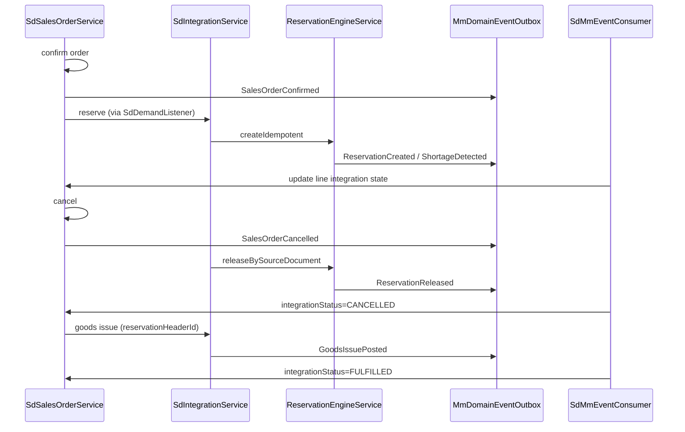

# MM ↔ SD Integration (Phase 3B)

Formal integration contract between **Sales & Distribution (SD)** and **Materials Management (MM)** for ATP, reservation, cancellation, quantity changes, and goods issue fulfillment.

Related: [MM_INTEGRATION_CONTRACTS.md](./MM_INTEGRATION_CONTRACTS.md) · [MM_INTEGRATION_EVENTS.md](./MM_INTEGRATION_EVENTS.md)

---

## Ownership

| Domain | Owns |
| --- | --- |
| SD | Sales orders, customer demand, shipment documents, integration state on `SdSalesOrderLine` |
| MM | Inventory balances, ATP, reservations, allocations, picking, goods issue, ledger |

SD **must not** write `MmInventoryBalance` or reservation tables directly. All stock operations go through the MM integration API.

---

## Integration API

Base path: **`/api/v1/mm/integration/sd`**

| Method | Path | Purpose |
| --- | --- | --- |
| POST | `/availability/check` | Single-material ATP |
| POST | `/availability/check-batch` | Multi-line cart check (SO confirm) |
| POST | `/availability/check-date` | ATP with required date metadata |
| POST | `/reservations` | Idempotent reserve from SD demand reference |
| POST | `/reservations/by-source/:sourceDocumentId/release` | Release all active reservations for SO |
| POST | `/reservations/by-source/:sourceDocumentId/adjust` | Partial release on qty decrease |
| GET | `/reservations/by-source/:sourceDocumentId/status` | Reservation/allocation snapshot |

Implementation: `backend/src/mm/integration/sd/`

---

## Event flow



### SD produces (MM consumes)

| Event | MM action |
| --- | --- |
| `SalesOrderConfirmed` | ATP batch check → idempotent reserve |
| `SalesOrderCancelled` | `releaseBySourceDocument()` |
| `SalesDemandChanged` | `adjustBySourceDocument()` per changed line |

Consumer: `MmEventConsumerService` with `consumerId: MM_SD_DEMAND` (`sd-demand.listener.ts`).

### MM produces (SD consumes)

| Event | SD action |
| --- | --- |
| `ReservationCreated` | Set `reservationHeaderId`, `reservedQuantity`, `integrationStatus` |
| `ReservationReleased` | Clear or reduce reservation; mark `CANCELLED` on full release |
| `ShortageDetected` | Set line `integrationStatus=SHORT` |
| `AllocationCreated` / `AllocationReleased` | Warehouse visibility (future SD UI) |
| `GoodsIssuePosted` | Increment `issuedQuantity`; `FULFILLED` when complete |

Consumer: `SdMmEventConsumer` (`consumerId: SD_FULFILLMENT`).

---

## Cancellation rules

1. SD `cancel()` sets order status `CANCELLED` **before** emitting `SalesOrderCancelled`.
2. MM `releaseBySourceDocument()` calls `cancel()` on each active header — releases warehouse qty, sets status `CANCELLED`/`RELEASED`. **No hard delete.**
3. Re-reserve on cancelled order → `400 Sales order cancelled or not active`.

---

## Quantity validation guards

| Risk | Guard |
| --- | --- |
| Duplicate demand | Idempotency key + unique active reservation per source document |
| Duplicate reservation | `createIdempotent()` returns existing header |
| Cancelled order | `SdOrderGuardAdapter` + SD status check |
| Qty decrease below issued | Rejected in `adjustLineQuantityBySource()` |
| Insufficient stock | ATP before confirm; `ShortageDetected` when partial reservation |

---

## Goods issue linkage

Sales fulfillment GI must include:

- `issuePurpose: SALES`
- `sourceDocumentType: SALES_ORDER`
- `sourceDocumentId`: sales order id
- `reservationHeaderId`: active reservation header

On post, `GoodsIssuePosted` includes `documentReferences` (SO, reservation, GI, inventory transactions) and SD line mapping via `demandReferenceLineId`.

---

## SD backend (minimal Phase 3B)

| Model | Purpose |
| --- | --- |
| `SdSalesOrder` | Header with `DRAFT \| CONFIRMED \| CANCELLED` |
| `SdSalesOrderLine` | Demand qty, reserved/issued qty, `integrationStatus` |
| `SdShipment` | Lightweight shipment stub |
| `SdEventOutbox` | SD domain event outbox |

Module: `backend/src/sd/`

---

## Product Catalog / storefront stock display

**Material Master defines the item. Inventory Management stores the stock.**
The SD Product Catalog (and the marketplace storefront) must display **live MM
inventory ledger** values, never the material master cache columns
(`MmMaterial.onHandQty` / `reservedQty`, which only re-sync on postings and drift).

```text
Product Catalog (SD)
  → GET /api/v1/sd/material-catalog-reference/batch/preview?companyId&materialIds&warehouseId?&plantId?
  → SdMaterialReferenceService
      → CommercialAvailabilityService.getCompanyMaterialLedgerByWarehouses()
          → InventoryAvailabilityService (MM-08 ATP authority)
              → MmInventoryBalance  (companyId + warehouseId + materialId)
  → MM ReorderRuleService.resolveParamsForWarehouses()  → max / safety stock thresholds
  → UomConversionsService                               → base UOM → sales UOM
```

### Response contract

| Field | Source |
| --- | --- |
| `onHand` | MM ledger on-hand for the scope |
| `reserved` | active reservations (unrestricted rows) |
| `available` | `unrestricted on hand − reserved` (sellable) |
| `maxStock` / `safetyStock` | MM stock thresholds (warehouse rule → company rule → material), **never** on-hand |
| `standardCost` | MM material valuation |
| `warehouseBreakdown` | per active warehouse ledger + thresholds |

### Scope rules

- `companyId` is **required** — MM is never queried without company scope, and a
  material that belongs to another company is rejected (400), not silently zeroed.
- `warehouseId` when a warehouse is selected, otherwise sellable stock is
  **aggregated across the company's active warehouses** (or the material's
  default warehouse when one is configured).
- `plantId` narrows the active warehouse list when supplied.
- **Sellable = pickable.** Commercial availability counts only stock that sits in
  a storage bin (`InventoryAvailabilityService.getPickableMaterialTotals` /
  `getPickableAvailabilityBatch`). Warehouse-level (bin-less) balances are
  on-hand but cannot be picked: allocation has no bin to pick from, so promising
  them creates orders that fail at "start fulfillment". Total on-hand (including
  bin-less stock) stays available for internal reports via
  `getCompanyMaterialTotals`.
- Batch previews are **fault isolated**: one unreadable material is returned in
  `failures[]` and the other materials keep their real stock. The UI must show
  the error, never a fabricated `0`.
- UOM: base = sales UOM → quantity as-is; otherwise MM UOM conversion is applied
  (a missing conversion is an explicit error, not a silent wrong number).

### Keeping stock pickable (receipts & legacy data)

- **Goods receipt without a scanned bin**: putaway is disabled by design, so
  `GoodsReceiptService.post` falls back to the warehouse's receiving-area bin
  (first ACTIVE bin in a `receivingAllowed` storage type, else any ACTIVE bin).
  Posted stock therefore always lands in a bin and stays pickable; a warehouse
  with no bin at all is rejected with a clear error.
- **Legacy bin-less stock**: move it into a bin with a bin transfer whose
  `sourceBinId` is omitted (OUT leg posts at warehouse level, IN leg into the
  destination bin). `npm run prisma:repair-unassigned-warehouse-stock` (dry run
  by default, `--apply` to execute) repairs existing balances through the
  standard posting engine.

### Variants

When a product has variants, the stock item is the **variant's linked material**;
the parent product's material is never used. `/sd/products/storefront/availability`
accepts `variantId` and falls back to the default active variant.

A VARIABLE product has **no** `SdProductMaterialAssignment` — the variant owns
its material and therefore its stock. A variant without a linked material
reports `NOT_MAPPED` (storefront ATP, checkout ATP, and the admin variant
table); it is never backed by the parent product's assignment. A SIMPLE product
keeps exactly one parent assignment because it has exactly one hidden default
variant, so the link stays unambiguous.

Migration `20261107120000_variant_owns_material` links a legacy VARIABLE
product's sole parent assignment to its variants and then deactivates the
parent assignment (rows are kept so the change is reversible).

---

## Tests

`backend/src/mm/integration/sd/sd-mm-integration.spec.ts` — cancel, qty change, idempotent reserve, cancelled guard, status snapshot.
`backend/src/sd/sd-material-reference.service.spec.ts` — Product Catalog MM ledger read, company/warehouse/plant scope, thresholds, UOM conversion, batch fault isolation.
`backend/src/sd/product.service.spec.ts` — storefront ATP from the MM ledger, variant vs parent material.
`backend/src/mm/materials/materials-mm01.spec.ts` — Material Master detail/list reads live ledger quantities.
`backend/src/sd/product-option-variants.service.spec.ts` — per-variant on-hand / reserved / available.
`backend/src/mm/inventory/inventory-availability-pickable.spec.ts` — pickable-only commercial availability (bin-less stock excluded), batch grouping.
`backend/src/mm/stock-ops/stock-ops.spec.ts` — goods receipt lands in the receiving bin when none is scanned; bin transfer from bin-less warehouse stock.
